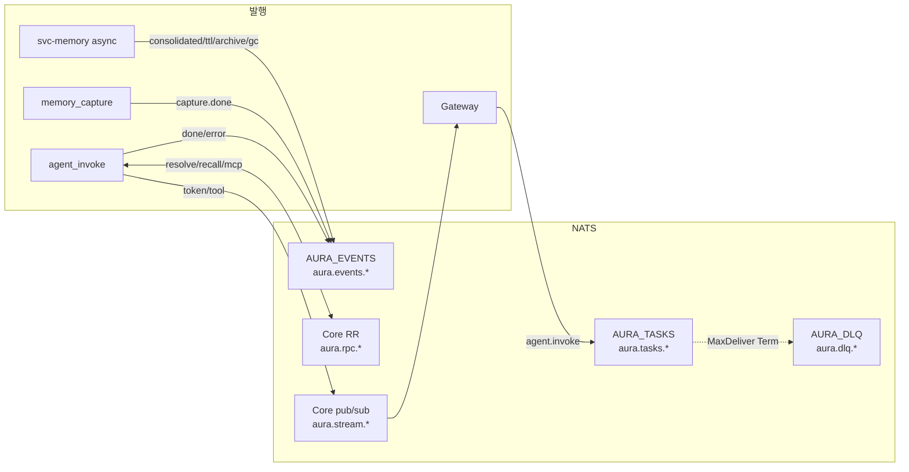
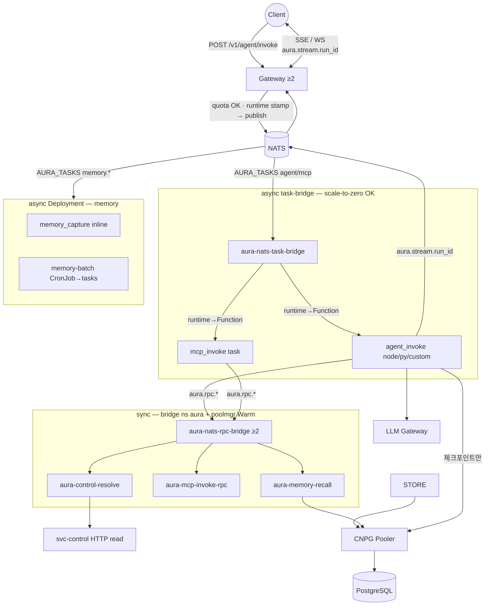
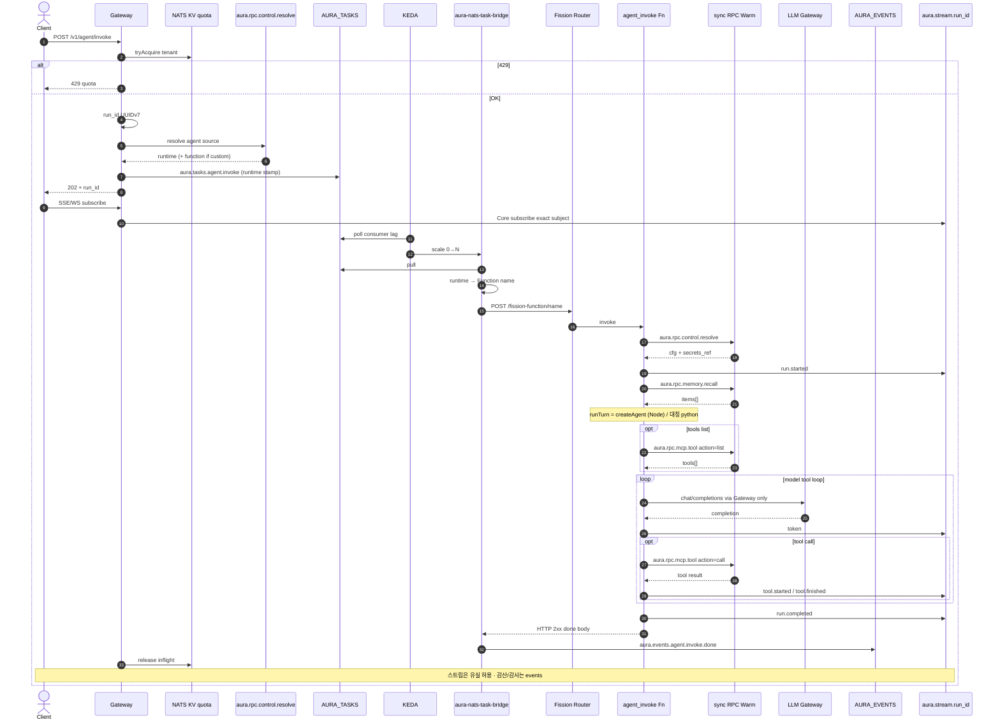
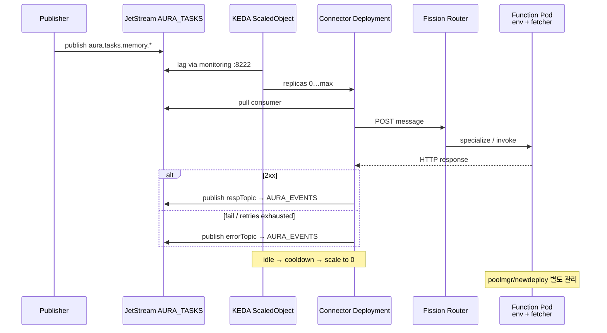
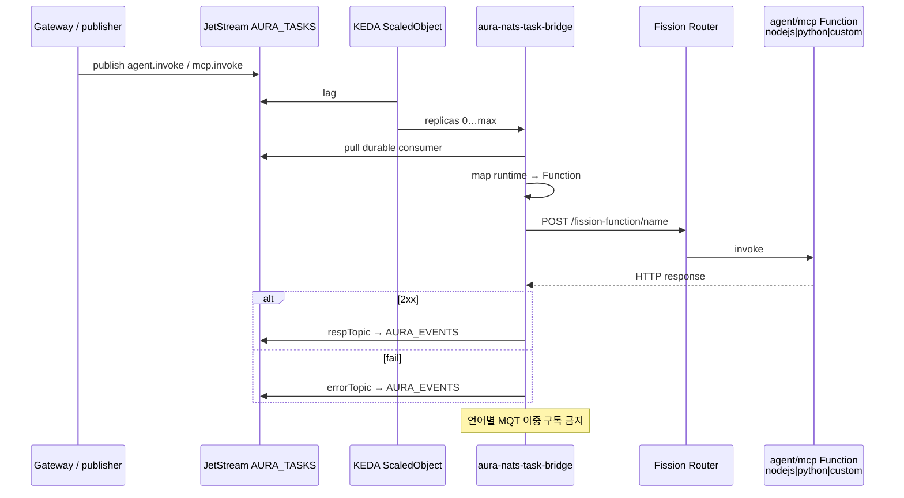
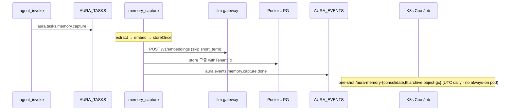
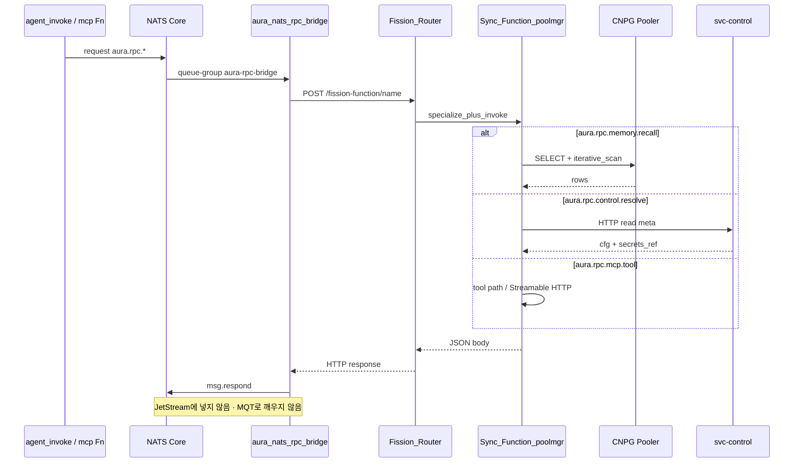

# MESSAGE-FLOW.md

Aura **전체 시스템 메시지·호출 흐름** 다이어그램이다.  
계약·스키마·subject 표의 정본은 [ARCHITECTURE.md](ARCHITECTURE.md). 컴포넌트 내부는 각 `DESIGN.md` / `deploy/docs/*`.

**이 문서 범위:** 채널 분류 · 대화형 invoke E2E(`createAgent` 턴) · async 이원화(MQT vs task-bridge) · 메모리 파이프라인 · sync RPC.  
**Non-goals:** DDL·페이로드 필드·archive 패키징·Fair Queue 수치(→ ARCHITECTURE / `deploy/docs`).

---

## 1. 채널 삼원화 (+ 이벤트)

| 채널 | 전송 | 용도 | 스케일 |
|------|------|------|--------|
| `aura.tasks.*` | JetStream WorkQueue → **Fission MQT** (memory 등) 또는 **task-bridge** (agent/mcp) | 내구 작업 | connector/bridge `min=0` OK |
| `aura.rpc.*` | NATS **Core** Request-Reply | 동기 홉 | **공용 브리지 ≥2** + sync poolmgr Warm, MQT 금지 |
| `aura.stream.*` | NATS **Core** pub/sub | UX 토큰/툴 (유실 허용) | Gateway 구독 |
| `aura.events.*` | JetStream Limits | 완료·감사 정본 | MQT/`task-bridge` `respTopic`/`errorTopic` |
| `aura.dlq.*` | JetStream Limits | MaxDeliver 초과 격리 | Term 경로 |

---

## 2. 토폴로지 개요

async는 **두 경로**다. memory 계열은 Fission MQT 1:1, agent/mcp는 동일 subject에 다중 `runtime`이 있어 **task-bridge**가 Function을 고른다.

---

## 3. 대화형 `agent.invoke` E2E

Gateway가 쿼터·resolve(`runtime` 스탬프)를 통과한 뒤에만 JetStream에 넣고, 실행 중 UX는 Core 스트림, **완료 정본은 events**다. agent/mcp async는 **MQT가 아니라 task-bridge**다.

실패 시 Function 비-2xx → task-bridge가 `aura.events.agent.invoke.error`로 적재. poison은 MaxDeliver 후 `aura.dlq.>` Term(ARCHITECTURE §3.2).

와이어 상세: [`deploy/docs/nats-task-bridge.md`](deploy/docs/nats-task-bridge.md) · [`deploy/docs/agent-invoke-mqt.md`](deploy/docs/agent-invoke-mqt.md) · [`deploy/docs/agent-invoke-create-agent.md`](deploy/docs/agent-invoke-create-agent.md) · [`deploy/docs/mcp-tools-list.md`](deploy/docs/mcp-tools-list.md) · [`deploy/docs/gateway-sse-ws.md`](deploy/docs/gateway-sse-ws.md) · [`deploy/docs/multi-env-followup.md`](deploy/docs/multi-env-followup.md).

---

## 4. Async 이원화: MQT vs task-bridge

### 4.1 memory 등 — Fission MQT

MQT마다 **역할이 다른 두 Deployment**가 있다. KEDA가 스케일하는 대상은 **커넥터**다. topic→Function **1:1**.

| 파드 | 하는 일 | Aura async 스케일 |
|------|---------|-------------------|
| **MQT connector** | JetStream pull → Router HTTP → resp/error publish (**언어 비선택**, Fission/KEDA 이미지) | MQT `minReplicaCount=0` |
| **Function** | 핸들러 실행 (env + fetcher). memory 등은 기존 MQT 유지 | executor·env pool |

### 4.2 agent / mcp — `aura-nats-task-bridge`

동일 subject에 nodejs·python·custom을 붙이면 MQT 1:1은 경쟁 소비가 된다. **브리지가 `runtime`(및 custom `function` allowlist)만 보고 Router로 중계**한다. 도메인 handler·PG는 브리지에 두지 않는다.

동기 `aura.rpc.*`에는 MQT/JetStream ScaledObject를 **붙이지 않는다**(No Responders). NATS 구독은 **`aura-nats-rpc-bridge`만** — Fission Router로 Sync Function(`poolmgr`) 중계. `aura.rpc.mcp.tool`도 `runtime`→Function 매핑.

상세: [`deploy/docs/nats-task-bridge.md`](deploy/docs/nats-task-bridge.md) · [`deploy/docs/multi-env-followup.md`](deploy/docs/multi-env-followup.md).

---

## 5. 메모리 파이프라인 (inline capture + batch CronJob)

`agent_invoke`는 `memory_*`에 직접 쓰지 않는다. 턴 종료 시 `aura.tasks.memory.capture` publish → capture 파드가 extract→embed→store 모듈을 **in-process** 실행. 배치(consolidate/ttl/archive/object_gc)는 **K8s CronJob**이 `/aura-memory-*` one-shot 실행(상시 파드 없음 · ARCHITECTURE §3.2 · §5 · [`memory-batch-cronjobs.md`](deploy/docs/memory-batch-cronjobs.md)).

대화 턴 중 **읽기**는 sync: `agent_invoke` → `aura.rpc.memory.recall` → bridge → `aura-memory-recall` → Pooler.

---

## 6. Sync RPC (bridge + poolmgr Warm)

---

## 7. 빠른 색인

| 보고 싶은 것 | 위치 |
|--------------|------|
| 계약·subject 표 | [ARCHITECTURE.md](ARCHITECTURE.md) §1–§4 |
| Gateway·Fair Queue | [`deploy/docs/gateway-sse-ws.md`](deploy/docs/gateway-sse-ws.md) · [`gateway-fair-queue.md`](deploy/docs/gateway-fair-queue.md) |
| agent/mcp task-bridge | [`deploy/docs/nats-task-bridge.md`](deploy/docs/nats-task-bridge.md) · [`multi-env-followup.md`](deploy/docs/multi-env-followup.md) |
| agent_invoke 순서 | [`deploy/docs/agent-invoke-mqt.md`](deploy/docs/agent-invoke-mqt.md) |
| mcp MQT+RPC | [`deploy/docs/mcp-invoke-dual.md`](deploy/docs/mcp-invoke-dual.md) |
| control.resolve | [`deploy/docs/control-resolve-bridge.md`](deploy/docs/control-resolve-bridge.md) |
| LLM egress | [`deploy/docs/llm-gateway.md`](deploy/docs/llm-gateway.md) |
