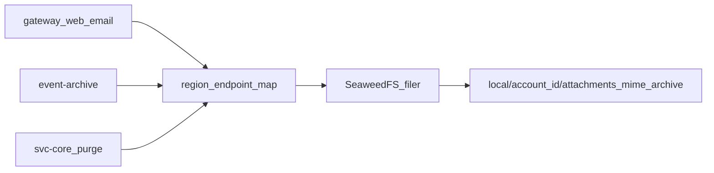
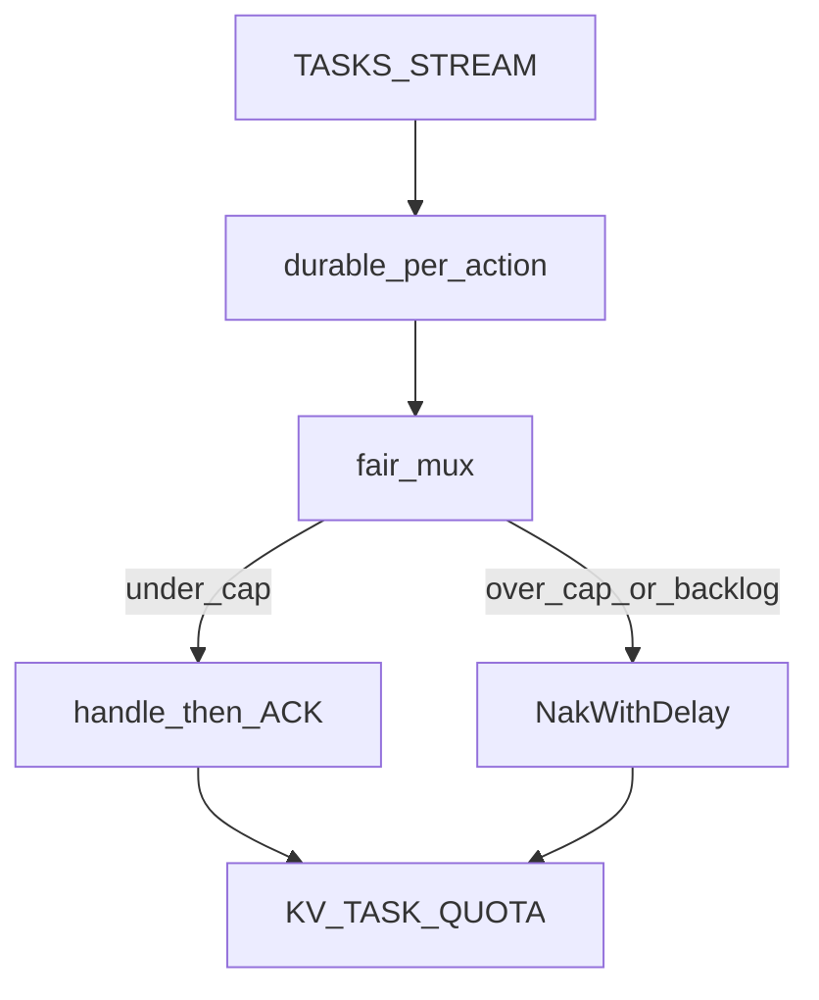

# P11 테넌트 버킷 · Task Fair Queuing

파일럿 한 클러스터에서 **테넌트 격리를 객체 키와 작업 큐에 심는다.** 리전은 클러스터 env이고, 두 번째 필러/DC는 띄우지 않는다. 게이트웨이는 PG가 없으므로 `accounts.region` 컬럼은 두지 않는다.

채택분은 계약·일정으로 승격한다. 정본은 [ARCHITECTURE.md](../ARCHITECTURE.md), [ROADMAP.md](../ROADMAP.md). 이 파일은 기획 원본이다.

## 가정 (이번에 하지 않는 것)

- Compose/k8s에 SeaweedFS를 하나 더 두지 않는다. `AURA_FILER_ENDPOINTS` JSON으로 리전→필러를 열고, 로컬은 `local` 한 칸만 채운다.
- 기존 `{account_id}/...` 객체 마이그레이션 없음. `external_url`은 절대 URL 스냅샷이라 옛 첨부는 그대로 열린다.
- NATS account 격리, PG 읽기 복제본, presence KV는 그대로 출시 후.

## 1. 계약부터

[ROADMAP.md](../ROADMAP.md)에 **P11**을 넣고 출시 후에서 두 줄을 뺀다. 결정 로그의 첨부 버킷을「prefix → `{region}/{account_id}/` 버킷 루트, 필러는 리전 맵」으로 옮긴다.

[ARCHITECTURE.md](../ARCHITECTURE.md):

- 객체 키는 `{region}/{account_id}/attachments|mime|archive/...`. 필러는 `AURA_REGION` + `AURA_FILER_ENDPOINTS`.
- Task 서브젝트는 `helpdesk.tasks.<domain>.<action>.<account_id>` (스누즈 wake는 뒤에 `.<conversation_id>`).
- §1.9 필터는 액션별로 겹치지 않게 `helpdesk.tasks.ai.reasoning.>` / `outbound.email.>` / `webhooks.deliver.>` / `snooze.wake.>` 로 고친다. `helpdesk.tasks.ai.>` 한 장은 reasoning/execute/embed가 한 메시지를 놓고 싸워서 쓰지 않는다. ([아키텍처_개선.md](아키텍처_개선.md)의 가운데 `account_id` 배치보다 액션 고정을 우선한다.)
- 워커는 테넌트 라운드로빈 + 동시실행 쿼터. 한 테넌트가 한 durable의 in-flight를 독점하지 않는다.

[backend/DESIGN.md](../backend/DESIGN.md) · [svc-ai-agent/DESIGN.md](../svc-ai-agent/DESIGN.md) 경로·서브젝트·env를 맞춘다.

## 2. 테넌트·리전 버킷

지금 [backend/internal/gateway/attach.go](../backend/internal/gateway/attach.go)는 `{account_id}/{attachment_id}/{filename}` 한 트리이고, MIME은 `{account_id}/mime/...`, 아카이브는 `archive/{account_id}/...`로 섞여 있다.

공통 키 헬퍼 (예: `backend/internal/blobkey`):

- `attachments/{id}/{filename}`
- `mime/{id}.eml`
- `archive/{conversation_id}/{yyyy-mm-dd}.jsonl`

루트는 `{region}/{account_id}/`. `FilerStore`는 리전 맵에서 PUT/GET/DELETE 엔드포인트를 고른다. env:

- `AURA_REGION` 기본 `local`
- `AURA_FILER_ENDPOINTS` 예: `{"local":{"url":"http://127.0.0.1:8888","public":"http://127.0.0.1:8888"}}` — 비면 지금처럼 `AURA_FILER_URL` / `AURA_FILER_PUBLIC_URL`

`contacts.purge`는 `archive/{account}/`가 아니라 `{region}/{account}/archive/{conversation}/`를 지운다.

TDD: [attach_test.go](../backend/internal/gateway/attach_test.go) · email claim-check · archive · purge 키가 `{region}/{account_id}/`로 시작하는지. 두 계정 PUT이 서로 다른 루트인지.

## 3. Task Fair Queuing

FIFO `Fetch(1)` + 쿼터만 두면 헤드를 채운 테넌트가 NAK를 반복해 이웃을 굶긴다. 서브젝트에 `account_id`를 넣고, 워커가 **테넌트 큐 + 라운드로빈**으로 디스패치한다.

서브젝트 예:

- `helpdesk.tasks.ai.reasoning.{account_id}`
- `helpdesk.tasks.outbound.email.{account_id}`
- `helpdesk.tasks.webhooks.deliver.{account_id}`
- `helpdesk.tasks.snooze.wake.{account_id}.{conversation_id}`

발행은 이미 payload에 `account_id`가 있다. 상수·필터를 [streams.go](../backend/internal/ingest/streams.go), [outbound.go](../backend/internal/gateway/outbound.go), [submit.go](../backend/internal/gateway/submit.go), core(article/tool/service/webhook/snooze), [engine.go](../backend/internal/automation/engine.go), [svc-ai-agent `__main__.py` / `agent.py`](../svc-ai-agent/src/aura_ai/__main__.py)에서 한곳으로 모은다.

워커 (`backend/internal/fairtask`, Python 동등):

- 테넌트별 메모리 큐. 백로그 초과면 즉시 `NakWithDelay` (기본 16, 200ms) → MaxAckPending을 한 테넌트가 채우지 못하게.
- 라운드로빈으로 큐에서 한 건씩 꺼낸다.
- JetStream KV `TASK_QUOTA` 키 `{durable}.{account_id}`를 `AGENT_CAPACITY`와 같이 revision CAS로 증감. in-flight ≥ `AURA_TASK_TENANT_CONCURRENCY`(기본 4)면 NAK.
- 채널 token-bucket/서킷([limit.go](../backend/internal/limit/limit.go))은 그대로 그 앞/뒤에 둔다.
- `MaxAckPending`은 1000 → 64 근처로 낮춰 공정 큐가 메시지를 붙잡고 있지 않게 한다.

로컬 배포 한 번: 옛 exact subject 메시지는 새 필터에 안 잡힌다. TASKS_STREAM을 재생성하거나 7일 `max-age`에 맡긴다.

TDD (핸들러 없이 mux만):

- A 20건 + B 1건 → B가 A의 마지막보다 먼저 ACK.
- concurrency=2일 때 A in-flight가 2를 넘지 않음.
- 서브젝트/필터 와일드카드 테스트 (기존 exact 비교·Python subscribe).

## 4. 수행 순서 (TDD)

문서 → blobkey/filer 맵 테스트·구현 → fairtask 테스트·구현 → Go 워커 배선 → Python 워커 배선 → 서브젝트/컨슈머 필터 → 관련 테스트 통과.

성공: 두 테넌트 첨부가 다른 `{region}/{account_id}/` 루트에 있고, 한 테넌트가 AI/아웃바운드/웹훅 큐를 막아도 다른 테넌트 작업이 진행된다.
